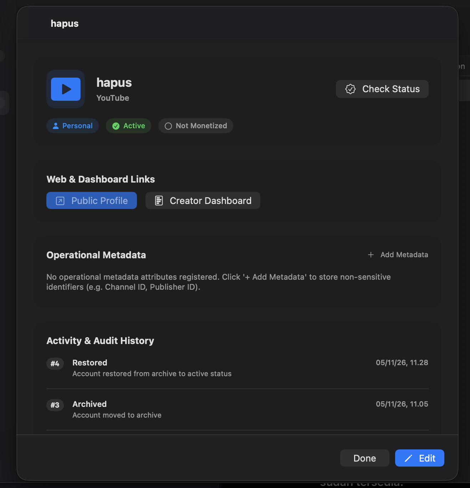
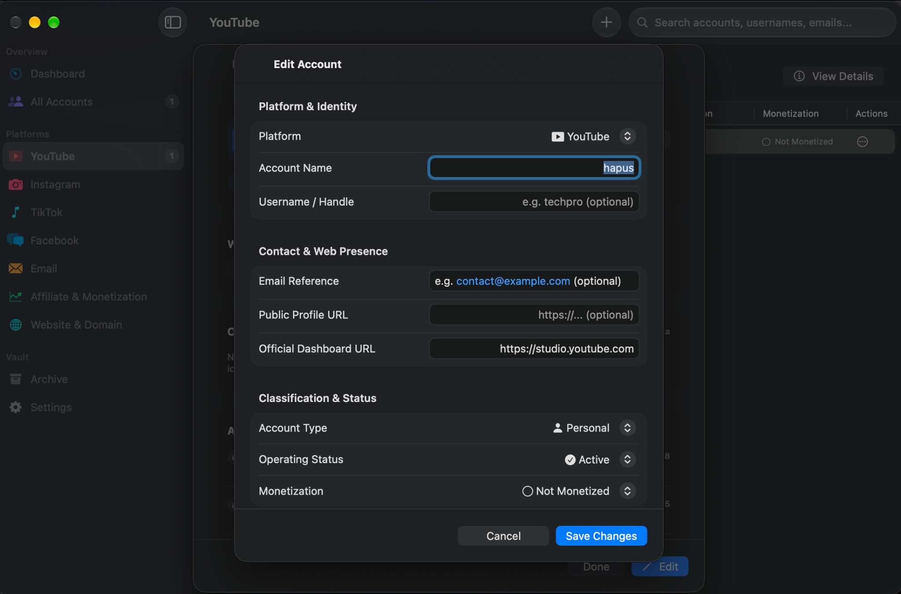
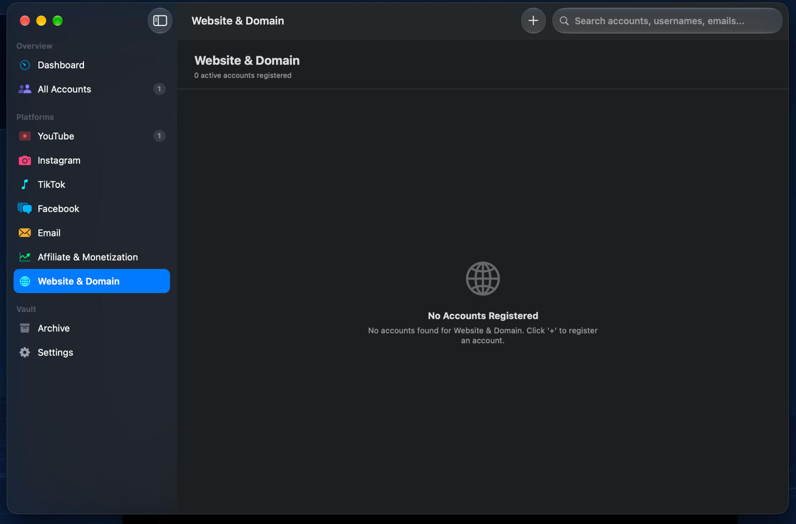
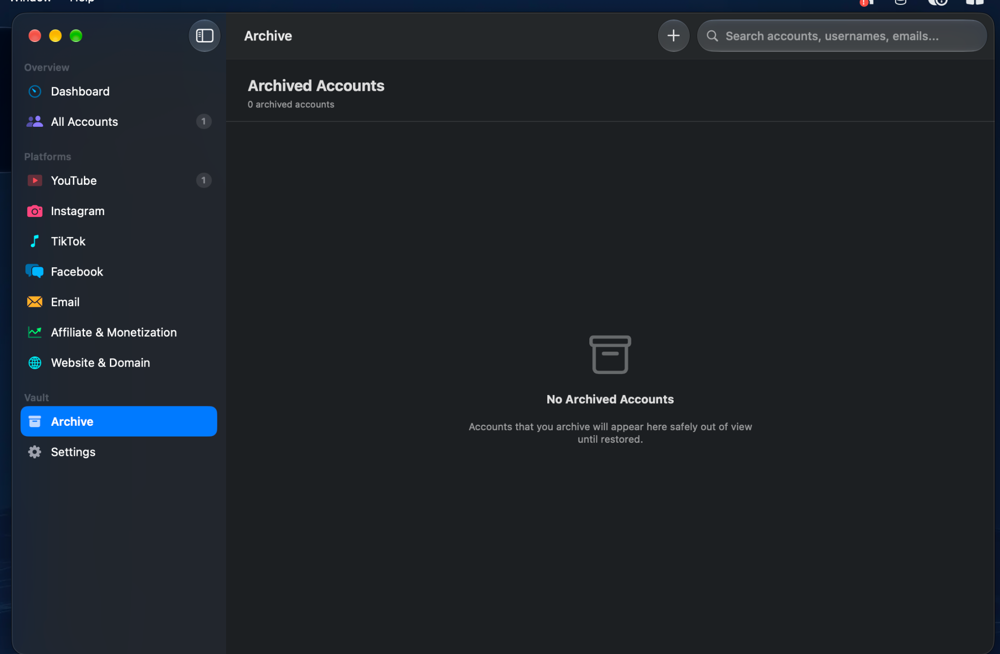
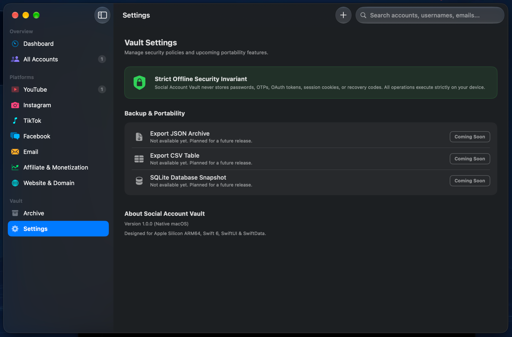

# Social Account Vault

[](LICENSE)
[](https://swift.org)
[](https://developer.apple.com/macos)

A privacy-first, offline native **macOS** application to catalogue, categorize, and audit your digital accounts and brand assets — without storing sensitive credentials.

> **Status:** V1 Personal Edition · **Ready with known limitations** (accepted for personal/local use).
> This repository is presented as an open-source project under the MIT License. Public binary distribution and notarization have **not** been completed.

---

## Overview

SocialAccountVault is built for creators, solopreneurs, and operators who want a single, local source of truth for account metadata (platforms, handles, monetization, recovery references, notes) while strictly excluding secrets.

- Local-first: data stays on your Mac in a SwiftData/SQLite store.
- **Zero-Credential Storage** — it never stores passwords, OTPs, recovery codes, seed phrases, private keys, session tokens, or API secrets.
- Native macOS UI (SwiftUI + AppKit), dark appearance, App Sandbox enabled.
- Safe link handling through `URLSafetyValidator` and `SafeLinkButton` only.

---

## Application Screenshots

### Account Details & Editing


_Account detail: platform identity, web/dashboard links, operational metadata empty state, and audit history._


_Edit Account sheet: platform/identity, contact & web presence, classification & status fields._

### Platform Categories & Archive


_“Website & Domain” category with no accounts registered yet (empty state)._


_Archive view showing zero archived accounts (empty state); archived items are restored from here._

### Settings & Security


_Vault Settings: strict offline security banner plus “Backup & Portability” items marked Coming Soon (not available in V1)._

---

## Core Features

- **Dashboard**: aggregated metrics, platform breakdown, recent activity, domain-expiration reminders.
- **Account CRUD**: create, view, edit, archive/restore, and delete with confirmation; UUID preserved across edits.
- **Structured metadata**: typed keys (`StandardMetadataKey`) for channel/page IDs, payout schedule/currency, device profile, and more.
- **Security metadata**: masked recovery phone hint, validated recovery email, 2FA status/method matrix, historical password-rotation date.
- **Lifecycle health**: “Mark Checked” tracking and expiration badges (30/60/90 days).
- **Safe links**: HTTPS-only scheme enforcement, canonical-domain allowlist (YouTube, Instagram, Facebook, TikTok), divergent-host confirmation dialog, blocking of userinfo/IP/port/Punycode tricks.
- **Storage failure safety**: a failed store halts writes, shows a banner, and preserves the on-disk file — no silent in-memory fallback.

---

## Core Categories

1. **YouTube** (Channels, Brand Accounts, YouTube Studio)
2. **Instagram** (Creator, Business, Personal profiles)
3. **TikTok** (Creator, TikTok Shop accounts)
4. **Facebook** (Pages, Meta Business Suite assets)
5. **Email** (Administrative, Outreach, Recovery reference emails)
6. **Shopee Affiliate** (Partner ID, Affiliate dashboards)
7. **Google AdSense** (Publisher accounts, Payment profiles)
8. **Website & Domain** (Domain portfolios, DNS providers, registrar records)

---

## Security Principles

- **Zero-Credential Storage.** Forbidden fields (password/PIN, OTP or 2FA secrets, recovery codes/seed phrases, session cookies, OAuth tokens, API/private keys) are rejected by static and runtime scanners.
- **Least-privilege sandbox.** Only `com.apple.security.app-sandbox` is enabled; network-client and user-selected-file entitlements were removed because no feature requires them.
- **Offline by default.** No telemetry, analytics, or background network services.
- **Fail-closed storage.** On store failure: writes halt, a non-dismissible banner appears, the database file is left untouched, and retry reopens the same file.

See [SECURITY.md](docs/SECURITY.md) for details.

---

## Technology Stack

- **Language:** Swift 6 (strict concurrency `-strict-concurrency=complete`)
- **UI:** SwiftUI + AppKit (`NSWorkspace`)
- **Persistence:** SwiftData backed by SQLite
- **Platform:** macOS 14+ · Apple Silicon (ARM64)
- **Build systems:** Xcode project and Swift Package Manager

---

## Architecture Overview

```text
App target (SocialAccountVaultApp)
        │
        ▼
Core framework (SocialAccountVaultCore)
  Views ──▶ ViewModels ──▶ Services ──▶ Models (@Model / enums)
                     │
                     ├─ DatabaseConfiguration / StorageCoordinator
                     ├─ VaultDataService (CRUD + audit + validation)
                     ├─ URLSafetyValidator + DomainRegistryLoader
                     └─ MetadataValidator / AccountLifecycle
```

All mutations route through `VaultDataService`, which gates writes via `StorageCoordinator`. Full details in [ARCHITECTURE.md](docs/ARCHITECTURE.md).

---

## Project Structure

```text
SocialAccountVault/
├── Package.swift                         # SwiftPM manifest (Swift 6, macOS 14)
├── LICENSE                               # MIT
├── SocialAccountVault.xcodeproj/         # Xcode project + shared scheme
├── Sources/
│   ├── SocialAccountVaultApp/            # App entry point
│   └── SocialAccountVaultCore/           # Core framework
│       ├── Models/                       # Account, AccountDetail, ActivityLog, enums, VaultError
│       ├── Views/                        # Navigation, Dashboard, Accounts, Archive, Components, Settings
│       ├── ViewModels/                   # NavigationViewModel
│       ├── Services/Data/                # DB config, StorageCoordinator, VaultDataService,
│       │                                 # URLSafetyValidator, DomainRegistryLoader,
│       │                                 # MetadataValidator, AccountLifecycle, CategorySeeder
│       └── Resources/                    # OfficialDomains.json, Info.plist, entitlements
├── Tests/SocialAccountVaultTests/        # Swift Testing suites
├── scripts/                              # build.sh, verify_phase_1.sh, verify_code_integrity.py
└── docs/                                 # Specs, reports, release notes, assets/screenshots
```

---

## Getting Started

### Prerequisites

- macOS 14.0+ (Sonoma/Sequoia)
- Apple Silicon Mac
- Xcode 16+ **or** Swift 6.0+ Command Line Tools

### Build & Run (Xcode)

1. Open `SocialAccountVault.xcodeproj`.
2. Select the **SocialAccountVault** scheme (My Mac).
3. `Cmd+R` to build and run.

### Build & Test (Terminal / SwiftPM)

```bash
swift build --configuration debug -Xswiftc -strict-concurrency=complete
swift test
```

> **Note:** The Xcode scheme’s test action does **not** execute the complete Swift Testing suite in this configuration. Use `swift test` for full coverage. `scripts/verify_phase_1.sh` provides a scripted build/test check.

---

## Project Status

- **Edition:** V1 Personal Edition.
- **Readiness:** READY WITH KNOWN LIMITATIONS.
- **Owner QA acceptance:** PASS 6/6.
- **Verified baseline (scope):** SwiftPM tests 186/186; integrity audit 280/280; scanner hardening 43/43; Xcode Debug/Release builds and Archive PASS; archived & release app smoke launch PASS.
- **Distribution:** Local personal use. No Developer ID signing, notarization, DMG packaging, Gatekeeper validation, or public binary release has been performed.

---

## Known Limitations

- **JSON export, CSV export, and database backup are Coming Soon** (disabled controls; no fake success).
- **Final app icon** is not yet provided.
- **V1.1 capabilities deferred:** advisory platform detection (AC-MOD2-2), workstation curation detail (MOD5-3), dedicated monetization audit logging (MOD6-3), cross-domain redirect/shortener detection (MOD8-4).
- **Manual QA pending:** interactive Dark-Appearance visual/interaction pass.
- Historical acceptance results are preserved (PASS 28 · PARTIAL 3 · FAIL 1 · BLOCKED 0); none have been silently promoted.

---

## Roadmap

- **V1.1:** JSON/CSV export + import/backup, advisory platform detection, redirect/shortener heuristics, icon finalization.
- **Future public distribution (separate phase):** Apple Developer Program enrollment, Developer ID signing, Hardened Runtime distribution configuration, notarization, DMG packaging, Gatekeeper validation.

---

## License

MIT License — see [LICENSE](LICENSE). Copyright © 2026 Ardiansyah (ANAK TERUBUK).
